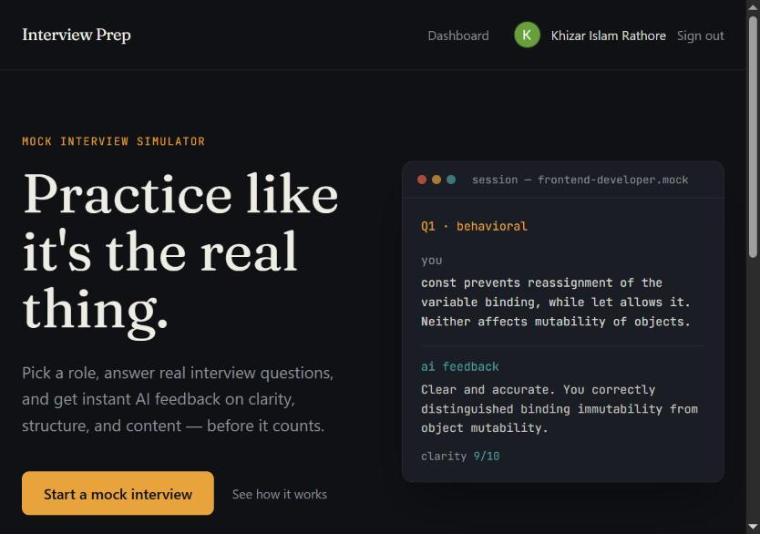
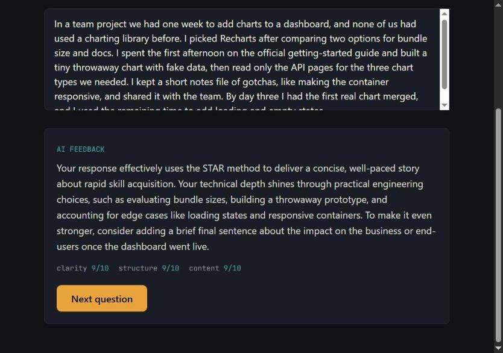
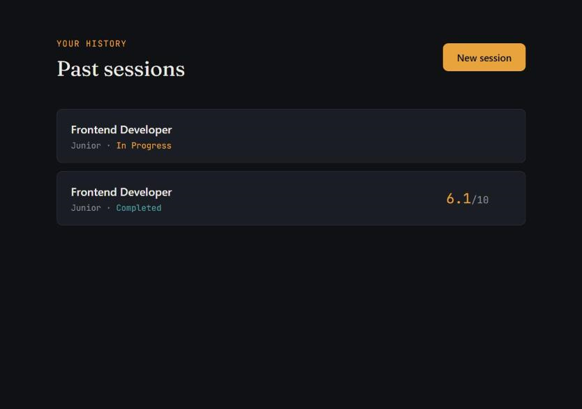

# Interview Prep Platform

Practice for a job interview with an AI interviewer. Pick a role and experience level, answer five generated questions, and get live-streamed feedback with scores on each answer.

**Live demo:** https://interview-prep-platform-xy36.vercel.app

> The API runs on a free host, so the first request after a quiet period can take up to a minute. Sign-in is Google only.







## What it does

- **Tailored questions.** Gemini writes five questions for your role and level: two behavioral, two technical and one system design.
- **Live feedback.** Feedback for each answer streams in as it is written, with scores out of 10 for clarity, structure and content. Behavioral answers are checked against the STAR method.
- **Session history.** Every session is saved with its questions, answers, feedback and scores.

## Design decisions

- **Streaming over SSE.** Feedback is sent as server-sent events from Express, so the text appears as the model writes it.
- **Signed API requests.** The web app signs a 5-minute token for the signed-in user (`GET /api/api-token`) and sends it as `Authorization: Bearer <token>`. The API verifies it (HS256, issuer and audience pinned, expiry) and takes the user id only from the token.
- **Ownership inside the query.** Every session, question and answer query is filtered by the signed-in user, so one user can never read or change another user's sessions. Another user's session returns 404, the same as a missing one.
- **Rate limits.** Creating sessions and submitting answers are limited per signed-in user and per IP address (hourly and daily), since each call uses the Gemini quota and one person could otherwise make many accounts. All API routes also have a loose per-IP cap.
- **No raw errors to the browser.** Unexpected failures are logged on the server and the browser only gets a short, fixed message.
- **Defensive JSON parsing.** Code fences are stripped from the model's output before parsing.
- **Cold start handling.** The free API host sleeps when idle. If creating an interview session takes longer than 3 seconds, the button shows a "Waking up the server..." seconds counter until it responds. If the free database is also asleep, the request retries once automatically.
- **Auth model names.** The interview model is called `InterviewSession` (mapped to the `sessions` table) so it doesn't clash with NextAuth's `Session`.

## Tech stack

| Layer | Tools |
|---|---|
| Frontend | Next.js (App Router), TypeScript, Tailwind CSS, Framer Motion |
| Auth | NextAuth with Google OAuth and the Prisma adapter |
| Backend | Node.js, Express |
| Database | PostgreSQL (Neon), Prisma |
| AI | Google Gemini |
| Hosting | Vercel (web), Render (API) |

## Project layout

```
backend/    Express API: sessions, answers, Gemini service, rate limiters
frontend/   Next.js app: home, new interview, interview page, dashboard
```

## API routes

All routes except `/health` need `Authorization: Bearer <token>`.

| Method | Path | What it does |
|---|---|---|
| GET | `/health` | Health check |
| GET | `/api/sessions` | Your sessions, newest first (replaces `/api/sessions/user/:userId`) |
| GET | `/api/sessions/:id` | One session with questions and answers |
| POST | `/api/sessions` | Create a session: `{ role, experienceLevel }` |
| PATCH | `/api/sessions/:id/complete` | Finish a session: `{ overallScore }` |
| DELETE | `/api/sessions/:id` | Delete a session |
| POST | `/api/answers` | Submit an answer, feedback streams back: `{ questionId, answerText }` |

## Run it locally

1. Create a Postgres database (Neon works) and a Google OAuth client.
2. In `backend/`, create `.env` with `DATABASE_URL`, `GEMINI_API_KEY`, `API_AUTH_SECRET`, `FRONTEND_ORIGIN` and `PORT`. Then run `npm install`, `npx prisma migrate dev` and `npm run dev`.
3. In `frontend/`, create `.env.local` with `DATABASE_URL`, `GOOGLE_CLIENT_ID`, `GOOGLE_CLIENT_SECRET`, `AUTH_SECRET`, `NEXT_PUBLIC_API_URL` and `API_AUTH_SECRET`. Then run `npm install` and `npm run dev`.
4. Open http://localhost:3000.

Both folders have a `.env.example` listing these variables.

| Variable | Where | What it is for |
|---|---|---|
| `DATABASE_URL` | both | Postgres connection string |
| `GEMINI_API_KEY` | backend | Gemini API key |
| `GEMINI_MODEL` | backend | Optional. Gemini model for questions and feedback, default `gemini-3.6-flash`. Empty or blank uses the default |
| `API_AUTH_SECRET` | both | Signs (web) and verifies (API) the sign-in tokens |
| `FRONTEND_ORIGIN` | backend | Web app URLs allowed by CORS, comma-separated, no trailing slash |
| `PORT` | backend | API port, default 5000 |
| `TRUST_PROXY_HOPS` | backend | Number of proxies in front of the API in production, 1 to 5, default 1. On Render it must be 3 (measured: visitor, Cloudflare, Render proxy); a wrong value makes every visitor share one IP counter |
| `GOOGLE_CLIENT_ID`, `GOOGLE_CLIENT_SECRET` | frontend | Google sign-in |
| `AUTH_SECRET` | frontend | NextAuth secret (`NEXTAUTH_SECRET` also works) |
| `NEXT_PUBLIC_API_URL` | frontend | API URL |

`API_AUTH_SECRET` must be the same on both sides, at least 32 characters, different from the NextAuth secret, and never prefixed with `NEXT_PUBLIC_`. The API won't start without it or `FRONTEND_ORIGIN`. To generate one: `node -e "console.log(require('crypto').randomBytes(36).toString('base64url'))"`

To run the auth tests, create a separate database branch (Neon: Branches, Create branch from your default branch), set it as `TEST_DATABASE_URL` in `backend/.env`, and run `npm run test:auth` in `backend/`. They check that missing or bad tokens get 401 and that one user can't read, change, delete or answer in another user's session. The script refuses to run if `TEST_DATABASE_URL` is the same as `DATABASE_URL` or on the same host.

`npm run test:config`, `npm run test:ratelimit` and `npm run test:model` in `backend/` need no database and never call Gemini.

## Deploying

Deploy the API (Render) first, then the web app (Vercel), with the same `API_AUTH_SECRET` on both and the Vercel URL in `FRONTEND_ORIGIN`. The new API closes the security hole on its own, and the new web app only works with it because it sends a token instead of a user id. Until the web app is redeployed, the old one gets 401 errors.

## Known limits

- Free-tier Gemini quotas limit how many sessions can run per day.
- Answers are typed text only; there is no voice or video practice.
- Scores come from the model and are a guide, not an assessment.

## Author

Khizar Islam Rathore, Software Engineering student at the University of Karachi.
GitHub: github.com/Khizar-Islam | LinkedIn: linkedin.com/in/khizar-islam-rathore
